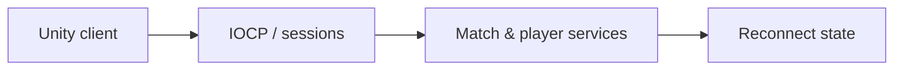

# CodeName VAIS

[English](README.md) · [Korean](README.ko.md) · [Japanese](README.ja.md)

**C++ · Windows IOCP · C# · Unity** · 현재 개발 중

[개발 사례 보기](https://ysl-ryudo.github.io/ko/work/vector/) · [Portfolio](https://ysl-ryudo.github.io/ko/)

정식 명칭은 **CodeName VAIS**이며 **Project Vector**는 이전 임시 이름입니다. 저장소명은 유지합니다.

**2026.03 - 현재 · 10명 · 소프트웨어 5명, 그래픽 5명**

서버 개발·Unity 멀티플레이 연동

팀으로 개발 중인 Unity 멀티플레이 FPS입니다. 게임 서버 연동과 경기·플레이어·지속적인 성장 정보를 연결하는 시스템을 담당했습니다.

## 해결하려던 문제

멀티플레이 FPS에서는 통신뿐 아니라 경기 수명주기와 플레이어에게 보이는 상태가 연결되어야 합니다. 재접속에서는 복구할 상태와 다시 실행하면 안 되는 행동을 구분해야 합니다.

## 내 구현과 설계

IOCP 서버의 세션·패킷 처리부터 Unity의 경기·프로필·상점 연동, 재접속 시 표시 상태 복원까지 작업했습니다. ReconnectJournal에는 지속 상태를 보관하고 피해·보상·플레이어 명령 재실행은 제외했습니다.

### 구현 개요 · 개념 흐름도

### 개발 시연 영상

- [Lobby UI](https://www.youtube.com/watch?v=WqRBn-yWVdo)
- [Store system](https://www.youtube.com/watch?v=OBFWkZE2rzo)
- [Profile system](https://www.youtube.com/watch?v=A3CkQvnQEGI)
- [Earlier Project Vector demo](https://www.youtube.com/watch?v=oga4ai_1Ugg)

촬영 당시의 프로젝트 시연입니다. 게임 안에서 제가 맡은 작업은 아래 기여 항목으로 구분합니다.

## 내 기여

- 센티널을 포함한 캐릭터 스킬의 패킷 처리와 게임플레이 연동을 구현했습니다.
- 매칭과 경기·결과 연출, 커리어·프로필 데이터, 친구, 상점 연동, 재접속·음성 클라이언트 흐름을 작업했습니다.
- 팀원이 제공한 컨트롤러 모델·모션 통합, ADS 정렬, 훈련장 확장과 에디터 검증 도구를 작업했습니다. 통합 작업을 모델·애니메이션 원작 제작으로 주장하지 않습니다.

## 기여 근거

- [Sentinel / 스킬 / スキル](https://github.com/YSL-RyuDo/projectVector/commit/756c9a09f32ed4a073d5d3d60008b1aaa44f0f60)
- [Practice & ADS / 훈련장·조준 / 訓練場・照準](https://github.com/YSL-RyuDo/projectVector/commit/f4457e2d77c251b9e0da5d976927303d04a64b43)
- [Reconnect & voice / 재접속·음성 / 再接続・音声](https://github.com/YSL-RyuDo/projectVector/commit/b62cbeeb16e72738d2dd7c491c8d42ec31afcd18)
- [Additional YSL work / YSL 추가 작업 / YSLの追加作業](https://github.com/YSL-RyuDo/projectVector/commit/5e5c3c53b010fb2807f6b53c0eb0f5ceec8d1350)

커밋은 설명한 변경의 근거이며 기여율 점수가 아닙니다. 외부 에셋과 팀원 작업의 크레딧은 구분합니다.

## 실행·코드 확인

[ProjectVersion.txt](ProjectSettings/ProjectVersion.txt)의 Unity 버전으로 프로젝트를 여세요. 패키지 잠금 파일과 직렬화된 에셋을 유지하고, Unity를 열기 전에 문서에서 설명한 브랜치를 선택하세요.

- Unity scene: [Assets/Scenes/Login.unity](Assets/Scenes/Login.unity)

[ProjectVectorServer](https://github.com/YSL-RyuDo/ProjectVectorServer)

## 개발·검증 범위

현재 개발 중입니다. 문서 기준 `YSL`에는 `main`에 아직 없는 이동·조준·명중 피드백·원격 움직임 작업이 있으며, 최신 main 변경을 모두 포함한 상태도 아닙니다. 시연 시 코드 버전을 명확히 선택해야 합니다. 기존 기록의 에디터·빌드 검사와 두 PC 실제 음성 통화·두 클라이언트 경기 검증은 구분합니다. 동시 접속 수용량이나 상용 운영 준비 완료를 주장하지 않습니다.

## 상세 문서

- [Docs/NextWorkSession.md](Docs/NextWorkSession.md)
- [Docs/ShopGachaImplementation.md](Docs/ShopGachaImplementation.md)

## 구현을 확인하는 방법

IOCP 코어, ReconnectJournal, 규격 테스트를 함께 보면 설계 의도를 따라갈 수 있습니다. 테스트 소스의 범위와 새로 수행하는 두 클라이언트 경기·두 PC 음성 검증은 구분합니다.
