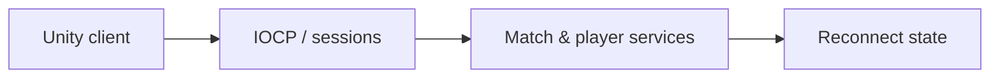

# CodeName VAIS

[English](README.md) · [Korean](README.ko.md) · [Japanese](README.ja.md)

**C++ · Windows IOCP · C# · Unity** · Active development

[Explore the case](https://ysl-ryudo.github.io/en/work/vector/) · [Portfolio](https://ysl-ryudo.github.io/en/)

**CodeName VAIS** is the official project name; **Project Vector** was the working title. Repository names are retained.

**Mar 2026 - Present · 10 members: 5 software, 5 graphics**

Server development & Unity multiplayer integration

A team-developed Unity multiplayer FPS. My focus is game-server integration and the systems that connect a match, its players, and their persistent progress.

## The engineering problem

A multiplayer FPS has to connect transport, match lifecycle and player-facing state. Rejoining a session also requires deciding what state to restore and what actions must not run again.

## My implementation

I worked across the IOCP server and Unity integration: sessions and packet dispatch, match/profile/shop flows, and reconnect presentation-state recovery. ReconnectJournal retains persistent state while excluding damage, rewards and player-command replay.

### Implementation overview · conceptual flow

### Development videos

- [Lobby UI](https://www.youtube.com/watch?v=WqRBn-yWVdo)
- [Store system](https://www.youtube.com/watch?v=OBFWkZE2rzo)
- [Profile system](https://www.youtube.com/watch?v=A3CkQvnQEGI)
- [Earlier Project Vector demo](https://www.youtube.com/watch?v=oga4ai_1Ugg)

Recorded project demonstrations; the contribution section below identifies my work within the game.

## My contribution

- Connected character abilities to packet handling and gameplay, including Sentinel ability integration.
- Worked on matchmaking and match/result presentation, career/profile data, friends, shop integration, and reconnect/voice client flows.
- Integrated team-provided controller models/motion, adjusted ADS alignment, expanded the practice range, and added editor verification tools. Integration does not mean authorship of the models or animations.

## Contribution evidence

- [Sentinel / 스킬 / スキル](https://github.com/YSL-RyuDo/projectVector/commit/756c9a09f32ed4a073d5d3d60008b1aaa44f0f60)
- [Practice & ADS / 훈련장·조준 / 訓練場・照準](https://github.com/YSL-RyuDo/projectVector/commit/f4457e2d77c251b9e0da5d976927303d04a64b43)
- [Reconnect & voice / 재접속·음성 / 再接続・音声](https://github.com/YSL-RyuDo/projectVector/commit/b62cbeeb16e72738d2dd7c491c8d42ec31afcd18)
- [Additional YSL work / YSL 추가 작업 / YSLの追加作業](https://github.com/YSL-RyuDo/projectVector/commit/5e5c3c53b010fb2807f6b53c0eb0f5ceec8d1350)

Commits are evidence of the stated changes, not a percentage-of-authorship score. Third-party assets and teammates' work remain separately credited.

## Open and inspect

Open the project with the Unity version recorded in [ProjectVersion.txt](ProjectSettings/ProjectVersion.txt). Keep its package lock and serialized assets intact. Select the documented branch before opening Unity.

- Unity scene: [Assets/Scenes/Login.unity](Assets/Scenes/Login.unity)

[ProjectVectorServer](https://github.com/YSL-RyuDo/ProjectVectorServer)

## Development and verification scope

Active development. At the documentation baseline, `YSL` contains additional movement, aiming, shot-feedback and remote-motion work that is not yet in `main`; it also does not include every newer main-branch change. Select a deliberate code revision for a demo. Existing records describe editor/build checks, but two-PC microphone communication and full two-client match verification remain separate checks. No concurrency capacity or production readiness is claimed.

## Further documentation

- [Docs/NextWorkSession.md](Docs/NextWorkSession.md)
- [Docs/ShopGachaImplementation.md](Docs/ShopGachaImplementation.md)

## How to evaluate the work

Read the IOCP core, ReconnectJournal and contract-test sources together. Separate the checked-in test coverage from a new two-client match or two-PC voice run.
